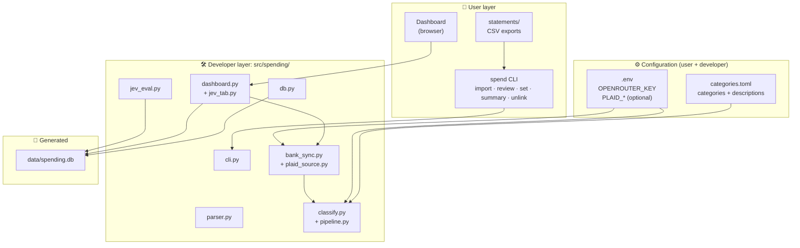
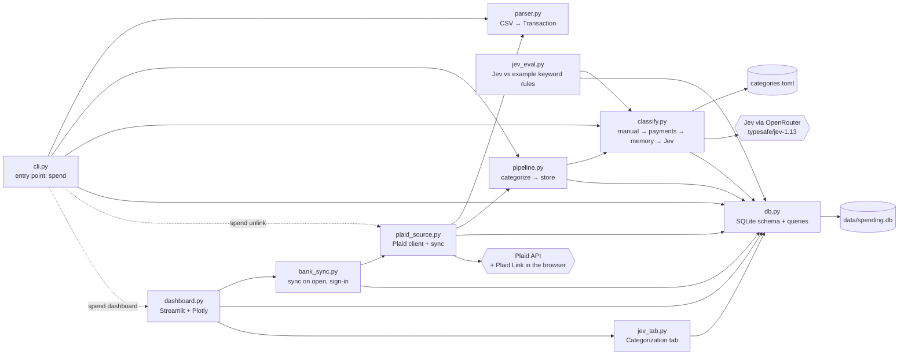
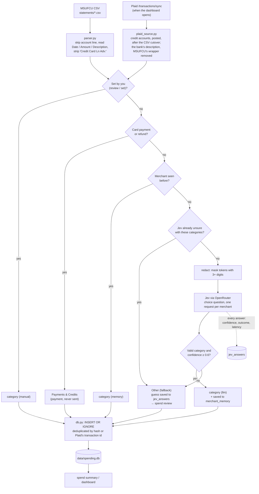
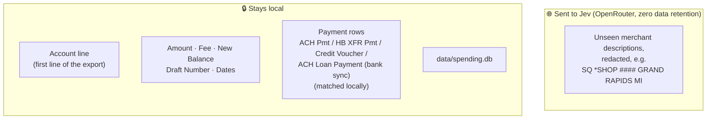

# Contributing

How the code is laid out and how to work on it. For using the app, see [README.md](README.md).

## Development setup

Commits are checked by [pre-commit](https://pre-commit.com) hooks: Ruff (lint + format), ty (type checking), whitespace fixes, and guards that block bank data, databases, `.env` and API keys. The tools are dev dependencies, so their versions are pinned in `uv.lock`.

```bash
uv sync                             # installs the dev tools too
uv run pre-commit install           # once per clone; covers all git worktrees
uv run pre-commit run --all-files   # check everything by hand
```

If a hook fixes files (Ruff, whitespace), the commit stops. Review the changes, `git add` them and commit again. ty checks the whole project on each commit, since type errors cross files. In VS Code, use the [ty extension](https://marketplace.visualstudio.com/items?itemName=astral-sh.ty) instead of Pylance: it shows the same errors the hook checks for, and the two overlap heavily anyway.

### Tests

Run the tests before and after any big change, especially to storage, bank sync or categorizing:

```bash
uv run pytest
```

They check that your data stays safe (the database and token file are private, tokens never reach the database, only redacted new merchants reach Jev, only keys and the token reach Plaid, bank data is git-ignored and blocked by the commit hook, the dashboard only listens on this machine), that imports never duplicate or overwrite your choices, and that bank sync handles new, changed, removed and pending transactions, paging and errors.

They run offline in a few seconds and never touch your data: each test gets its own throwaway database, the example categories, no API keys, and a fake Plaid (`tests/fakes.py`) with made-up transactions. Any real network request fails the test.

## Project structure

Paths marked "git-ignored" belong to each user and are never committed.

```
.
├── .claude/settings.json       Claude Code permissions (see CLAUDE.md)
├── .env                        keys and settings, copied from .env.example (git-ignored)
├── .env.example                template for .env, with every setting explained
├── .pre-commit-config.yaml     commit hooks: Ruff, ty, whitespace, bank-data and API-key guards
├── CLAUDE.md                   rules for Claude: commits, pull requests, issues
├── CONTRIBUTING.md             this file
├── README.md                   usage
├── categories.toml             the user's categories and descriptions (git-ignored)
├── categories.example.toml     template for categories.toml; change the default categories here
├── data/                       the database, and the Plaid token without an OS keyring (git-ignored)
├── documents/                  feature proposals (see Proposals below)
├── pyproject.toml, uv.lock     dependencies, the `spend` entry point, dev tools and their settings
├── src/spending/
│   ├── .streamlit/config.toml  dashboard server settings
│   ├── cli.py                  entry point: `spend …`
│   ├── parser.py               CSV → Transaction
│   ├── classify.py             categories, the payment check, redaction, Jev
│   ├── pipeline.py             categorize → store, shared by CSV import and bank sync
│   ├── db.py                   SQLite schema, migrations, queries
│   ├── plaid_source.py         Plaid client, /transactions/sync, token storage
│   ├── bank_sync.py            the dashboard's sync on open and sign-in card
│   ├── dashboard.py            Streamlit app and its Spending tab
│   ├── jev_tab.py              the Categorization tab
│   └── jev_eval.py             `python -m spending.jev_eval`: Jev vs the example keyword rules
├── statements/                 the user's CSV exports (git-ignored)
└── tests/                      offline tests; fakes.py is a fake Plaid
```

- **`data/`**: `spending.db` (SQLite) is created on first import, with the tables `transactions`, `merchant_memory`, `jev_answers`, `jev_evals` and `plaid_items`, each commented in `db.py`. `plaid-tokens.json` holds the Plaid access token, only where there's no OS keyring (e.g. WSL). The folder and its files are created owner-only (700 / 600).
- **`src/spending/.streamlit/config.toml`** applies however the dashboard is started: it listens only on `127.0.0.1`, accepts only the hostnames `localhost` and `127.0.0.1` (blocks DNS rebinding), and sends no usage statistics.
- **`categories.toml`** is copied from the example at setup, and `+` in `spend review` adds to it. Its `[rules]` are only labels for `jev_eval`; imports don't use them. Each git worktree needs its own copy, or set `SPENDING_CATEGORIES` in `.env` to share one.

## Proposals

A feature starts as a proposal in `documents/`: the doc holds the design, and a GitHub issue tracks the work. The doc's first line is its status, `**Status: open** ([#N](…))`, with a short note on what's built. When the work is done, move what still matters into README.md or this file and delete the proposal; its history stays in git and in the issue. This table is the only list of proposals, so update it when you add or delete one.

| Proposal | Status | About |
|---|---|---|
| [checking-ideas.md](documents/checking-ideas.md) | open ([#7](https://github.com/alessandrofelici/spending-tracker/issues/7)) | Import the checking account too (rent, investing, P2P), pairing card payments so nothing counts twice. First to verify: what a real checking CSV looks like. |
| [limit-flags.md](documents/limit-flags.md) | open ([#6](https://github.com/alessandrofelici/spending-tracker/issues/6)) | Fewer CLI flags: replace `review --resort` with change detection; maybe merge `--dry-run` and `--no-llm`. |
| [plaid-ideas.md](documents/plaid-ideas.md) | open ([#8](https://github.com/alessandrofelici/spending-tracker/issues/8)), MVP built | Pull transactions through Plaid. Built: sync when the dashboard opens, sign-in, `spend unlink`. Not yet: Plaid's categories, `spend sync`, a schedule. First to verify: how long MSUFCU's consent lasts. |

[jev-review.md](documents/jev-review.md) isn't a proposal but a reference that stays: what Jev is, how accurate it is against the keyword rules, and its speed and cost against a chat LLM. The dashboard's Categorization tab links to it.

Not covered by a proposal yet:

- When `categories.example.toml` gains a category, existing users' copies don't get it. Is a release note enough, or should `spend` point out example categories missing from your copy?

## Layers



## Module dependencies



## Import pipeline (what runs on `spend import` and on bank sync)

Both sources go through `pipeline.py`, so a row from Plaid is categorized exactly like one from a CSV.



## Privacy boundary

Only the Description column ever leaves the machine, and payment rows never do.

Bank sync adds a different kind of trust: Plaid reads the accounts you share in Plaid Link, at the bank. The app only sends Plaid its keys and the access token, never your data, and it only stores credit-account rows.


