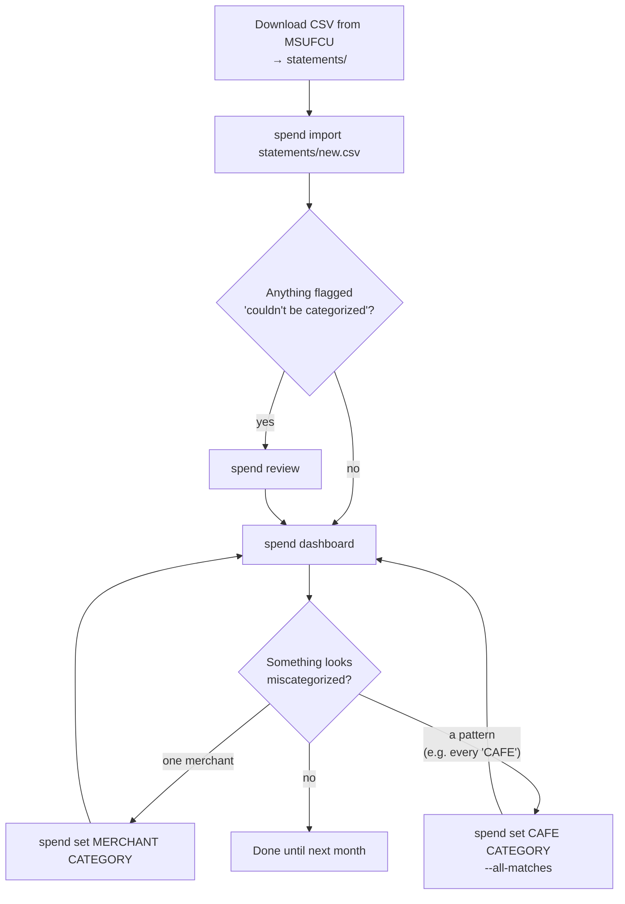

# Spending Tracker

Import MSUFCU credit card transaction CSVs (Online Banking → Download Transactions), categorize every transaction, store them by month, and chart your spending.

Everything runs locally. The only thing that ever leaves your machine is a redacted merchant name sent to [Jev](https://openrouter.ai/docs/guides/community/jev) (via OpenRouter) for stores it has never seen (see [How categorization works](#how-categorization-works)).

Optionally, the dashboard can pull your card's transactions from the bank through Plaid instead of you downloading CSVs (see [Bank sync](#bank-sync-plaid)).

## First-time setup

```bash
# 1. Install dependencies (Python 3.11+, uv)
uv sync

# 2. Make your settings file, then add your OpenRouter key to it
cp .env.example .env

# 3. Make your own categories (TODO: edit them to fit your spending)
cp categories.example.toml categories.toml

# 4. Download transactions from MSUFCU and put the CSV in statements/

# 5. Import everything you have
uv run spend import statements/*.csv

# 6. Fix whatever the LLM couldn't place, then look at the charts
uv run spend review
uv run spend dashboard
```

`categories.toml` is yours: it's git-ignored, so the categories and descriptions you add (by hand or with `+` in `spend review`) never end up in git. Before your first import, look through it: drop categories you don't need, add ones you do, and make the `[descriptions]` say what belongs in each, since that's what Jev reads. Its `[rules]` don't categorize anything; they're example labels for [checking Jev](#checking-jev-against-keyword-rules).


## Commands

All commands run as `uv run spend <command>`. Add `--help` to any of them for the full option list.

| Command | What it does | Changes data? |
|---|---|:-:|
| [`import`](#spend-import) | Read CSV export(s), categorize, store | ✅ |
| [`review`](#spend-review) | Walk through uncategorized merchants, pick or create categories | ✅ |
| [`set`](#spend-set) | Set one merchant's category directly | ✅ |
| [`dashboard`](#spend-dashboard) | Open the charts in your browser, after syncing with your bank if [set up](#bank-sync-plaid) | only with bank sync |
| [`unlink`](#disconnecting) | Disconnect your bank: revoke Plaid's access and delete the token | ✅ |

### `spend import`

```bash
uv run spend import FILE [FILE ...]
```

- Reads one or more MSUFCU CSV exports. It skips the account line at the top and uses only Date, Amount and Description. Balance and draft number are ignored.
- Removes the `Credit Card Ln Adv:` prefix from purchase descriptions.
- Categorizes each transaction (see [order](#how-categorization-works)) and saves it to `data/spending.db`.
- **Safe to repeat:** transactions are deduplicated, so overlapping downloads or re-importing the same file adds nothing twice.
- Transactions are grouped by the month they happened in, not by statement period.
- Without `OPENROUTER_KEY` in `.env`, new merchants aren't sent to Jev: they become `Other` for `spend review`.

```
$ uv run spend import statements/oct.csv
oct.csv:
  Asking Jev about 12 new merchant(s)...
  1 merchant(s) below confidence 0.6; left as 'Other' for review.
  64 transactions (2026-09 to 2026-10), 31 new.
  2 couldn't be categorized; run `spend review` to fix them.
```

### `spend review`

```bash
uv run spend review [--all]
uv run spend review --resort [CATEGORY]
```

Shows each merchant that ended up as `Other` (fallback), biggest total first, and asks for a category. Your answer:

- updates **all** past transactions from that merchant, and
- is remembered as a **manual** choice that beats rules and the LLM on every future import.

When Jev had a guess it wasn't confident enough to use, the prompt shows it with its confidence, and Enter accepts it.

| Key | Action |
|---|---|
| A number | Set that category |
| Enter | Accept Jev's `[suggestion]`, or skip if there is none |
| `+` | Create a new category (see below) |
| `s` | Skip this merchant |
| `q` | Stop (choices so far are saved) |

`--all` reviews every merchant that you haven't set by hand, including ones Jev categorized. Use it after the first import to spot-check Jev.

```
   1. Groceries
   2. Dining
   ...
  13. Other
Number = set that category, Enter = accept the [suggestion] (or skip if there is none), + = new category, s = skip, q = quit.

PETSMART 1234 LANSING MI  (1x, $42.10, now: Other, Jev: 55%) [Shopping] > 3
  -> Shopping (1 transactions updated)
MYSTERY LLC LANSING MI  (1x, $30.00, now: Other, Jev: no answer) > s
```

#### Adding a category

When a merchant doesn't fit any category, type `+` (or `+Pets`) at its prompt. You're asked for the name and an optional description (Jev reads it, so say what belongs there). The category is added to `categories.toml` just before `Other`, and the merchant is moved into it.

Then everything is **re-sorted** with the new category, because Jev's earlier answers were picked without it:

1. Jev is asked again about every merchant except card payments and refunds, which are never sent.
2. Merchants still in `Other` that Jev now confidently puts in the **new** category are moved right away, and listed. If Jev now confidently picks an **existing** category for one, it isn't moved: that pick becomes its `[suggestion]` in review. (Adding a category shifts Jev's confidence across all of them, so these are often borderline.)
3. Merchants **Jev** had put in another category that it now confidently puts in the **new** one are moved too, and listed. Jev picked their old category before the new one existed, so this only replaces its own answer.
4. Merchants **you** set by hand that Jev thinks belong in the new category are shown for you to confirm (their prompt says `set by you`). Enter accepts the move. Jev never moves your choices on its own, and it doesn't reshuffle merchants between categories that already existed.
5. Whatever is still `Other` follows in the same review.

The summary splits every merchant it looked at into these groups, so the numbers add up:

```
PETSMART 1234 LANSING MI  (1x, $42.10, now: Other, Jev: 55%) [Shopping] > +
  New category name (Enter to cancel): Pets
  What belongs in 'Pets'? Jev reads this when choosing (optional): Pet food, supplies, vets
  -> Pets (1 transactions updated)

Asking Jev about 5 merchant(s) with the current categories...
In 'Other': 3 merchant(s)
  1 placed by Jev in 'Pets':
    BARK BOX NEW YORK NY -> Pets
  2 still 'Other' (Jev unsure about 1, no answer for 1); review below
Already categorized: 3 merchant(s)
  1 moved by Jev (it picked them before 'Pets' existed):
    BOOKNOOK OKEMOS MI (Shopping) -> Pets
  1 you set by hand that Jev thinks belong in 'Pets'; confirm below
  1 keep their category
...
CHEWY.COM  (2x, $61.40, now: Shopping (set by you), Jev: 92%) [Pets] >
  -> Pets (2 transactions updated)
```

`--resort CATEGORY` runs the same re-sort on its own, e.g. after adding a category to `categories.toml` by hand. Plain `--resort` only retries the `Other` pile with the current categories, and applies any confident answer. Either way, a merchant is only re-sent to Jev if the categories or their descriptions changed since it was last asked, or the last request failed.

### `spend set`

```bash
uv run spend set MERCHANT CATEGORY [--all-matches]
```

The non-interactive version of `review`: fix one merchant without walking a list. `MERCHANT` can be part of the name, matched case-insensitively.

- One match: it's updated.
- Several matches: they're listed, and nothing changes until you use the exact name or add `--all-matches`.
- `CATEGORY` must be one from `categories.toml` (quote names with spaces: `"Gas & Transport"`).

```
$ uv run spend set kroger Shopping
KROGER EAST LANSING -> Shopping (2 transactions)

$ uv run spend set e Health
'e' matches 4 merchants:
  JIFFY PUZZLE CO OKEMOS
  ...
Use the exact name, or add --all-matches to set them all.
```


### `spend dashboard`

```bash
uv run spend dashboard
```

Starts a local Streamlit app at `http://127.0.0.1:8501` and opens it in your browser (stop with Ctrl+C). If [bank sync](#bank-sync-plaid) is set up, it first gets new transactions from your bank, or asks you to sign in. Only this computer can open it (see [Security and privacy](#security-and-privacy)). It shows:

- month picker with total spent, change vs the previous month, transaction count and biggest category
- spending by category for the month
- month-by-month stacked bars (top 7 categories, the rest grouped)
- top 10 merchants and a filterable transaction table, with each row's categorization **source**

## Bank sync (Plaid)

Optional. Instead of downloading CSVs, the dashboard can pull your card's transactions from the bank through [Plaid](https://plaid.com). Each time `spend dashboard` opens, it asks Plaid what changed since last time and runs new transactions through the same [categorization](#how-categorization-works) as `spend import`: your choices, the local payment check, remembered merchants, then Jev. Then it shows them.

### Setup

1. Create a free account at [dashboard.plaid.com](https://dashboard.plaid.com/signup). The sandbox (Plaid's test banks) works right away. For your real bank, apply for the free **Trial plan** ("Personal use").
2. Copy the keys from [Developers → Keys](https://dashboard.plaid.com/developers/keys) into `.env`, and make the file private, since it now holds a bank-access secret (`chmod 600 .env`):
   ```bash
   PLAID_CLIENT_ID=...
   PLAID_SECRET=...     # the secret for the environment below; each has its own
   PLAID_ENV=sandbox    # or production, for your real bank
   ```
3. Run `uv run spend dashboard` and click **Sign in to your bank** in the "Connect your bank" card. Plaid's window opens: pick your bank and sign in on the bank's own page. When it asks which accounts to share, pick only your credit card. In the sandbox, sign in with `user_good` / `pass_good` (and `1234` if asked for a code).

The first sync takes a few seconds while Plaid fetches your history. From then on, a line under the title says what each sync found:

```
Synced with MSUFCU just now: 3 new, 0 updated, 0 removed. 1 to categorize with `spend review`.
```

### What it stores

- **Credit accounts only:** the card, or a credit line. Checking and savings are skipped (listed as "Not tracked"): until [checking support](documents/checking-ideas.md) exists, card payments would count twice.
- **Posted transactions only:** pending ones wait until they post.
- **No double counting:** when you connect your bank, the newest date already stored becomes the cutover, and Plaid's transactions up to that date are skipped. That covers your CSV imports, and transactions synced before you disconnected and reconnected. After connecting, don't import CSVs covering later dates; those transactions would be counted twice.
- **Descriptions like the CSV's:** through Plaid, MSUFCU wraps each purchase as `Credit Card Advance <merchant> Date MM/DD/YY <reference> <nnnn> Card #<last 4>`. Only the merchant part is kept, so merchants you've already categorized are recognized, and no date goes to Jev.
- **Changes from the bank:** if Plaid reports a new amount or description, the row is updated and keeps its category. A transaction Plaid removes is deleted. Rows from CSV imports are never touched.

### Signing in again

Now and then your bank ends the connection. The dashboard then says your bank needs you to sign in again and shows a **Sign in again** button, which reconnects the same login (Plaid's update mode). Use it rather than starting over: on the Trial plan each new connection takes one of 10 slots, and disconnecting never frees one.

If you do connect again from scratch, the app revokes the login it replaces at Plaid. If Plaid can't be reached right then, the new connection still works, and the dashboard retries the revoke each time it opens.

### Disconnecting

```bash
uv run spend unlink
```

Asks first, then revokes the app's access at Plaid and deletes the access token. Transactions already synced stay. Some banks that sign you in through their own page still list the app as connected afterwards, so check your bank's connected-apps settings too. Connecting again later counts as a new connection on the Trial plan.

### Security and privacy

- Your bank password goes only to your bank's own page, opened by Plaid. This app never sees it.
- Plaid can read the accounts you share, so share only the card.
- Plaid gives the app an **access token** for your login. It's kept in your OS keyring (Windows Credential Manager, macOS Keychain or a Linux keyring). Where there is none, as in WSL, it goes in `data/plaid-tokens.json`, readable only by your user. The dashboard says which one it used when you connect. The token never goes to the browser.
- The dashboard only accepts connections from this computer (`127.0.0.1`), and only under the names `localhost` and `127.0.0.1`, so a web page can't reach it by pointing its own domain at your machine (DNS rebinding). It also doesn't send Streamlit's usage statistics. These settings are in `src/spending/.streamlit/config.toml`.
- `data/` and the database are created readable only by you. For a setup from before this, tighten them by hand: `chmod 700 data && chmod 600 data/* .env`.
- Jev still only gets redacted merchant descriptions, exactly as with a CSV import.

Not built yet: syncing on a schedule without opening the dashboard, and using Plaid's own categories as a hint. See [plaid-ideas.md](documents/plaid-ideas.md).

## The monthly cycle



In practice, monthly:

1. **Download** the last month (or more; overlap is fine) into `statements/`.
2. **`spend import statements/<file>.csv`**: usually only a handful of new merchants go to the LLM.
3. **`spend review`** if the import says anything couldn't be categorized.
4. **`spend dashboard`** to look at the month.
5. **Correct** anything wrong with `spend set` (with `--all-matches` for a pattern). Corrections stick, so each month needs less fixing.

With [bank sync](#bank-sync-plaid), steps 1 and 2 happen by themselves whenever you open the dashboard.

## How categorization works

Each transaction takes the first answer it gets:

1. **Your manual choices** from `review` / `set` take priority.
2. **Card payments and refunds** (`ACH Pmt:<account numbers>`, `HB XFR Pmt`, `Credit Voucher`, `ACH Loan Payment` from bank sync, ...) go to `Payments & Credits`, matched locally. They never reach the model.
3. **Merchant memory:** a merchant the LLM already categorized on an earlier import.
4. **Jev via OpenRouter,** only for merchants never seen before. Jev is TypeSafe's typed decision model: it doesn't write text, it picks one of your categories and returns a probability for each.
   - Only the Description column goes out, with any token containing 3+ digits (account/reference/phone numbers) masked. Amount, balance, draft number, dates and the account line at the top of the export are never sent.
   - Each merchant is its own request, so one odd description can't affect another's answer. Requests run 8 at a time.
   - The answer can only be one of your categories (checked again locally). If Jev's confidence is below `JEV_MIN_CONFIDENCE` (default 0.6), or it picks `Other`, the merchant goes to `spend review` instead of being guessed. Its guess is kept and offered as the default in review, and the merchant isn't asked about again until you change the categories or their descriptions.
   - Requests are restricted to zero-data-retention endpoints (`provider.zdr`).
   - Cost: about $0.00003 per merchant (input tokens only).
   - Every answer, including unsure and failed ones, is kept with its confidence and latency (the `jev_answers` table) for review suggestions.
5. **Fallback:** anything left becomes `Other` and shows up in `spend review`.

The **source** column in the dashboard's transaction table tells you which step decided each row:

| source | Meaning |
|---|---|
| `manual` | You set it |
| `payment` | Card payment or refund, matched locally |
| `memory` | Merchant seen on an earlier import |
| `llm` | Categorized by Jev (on import, or by a review re-sort) |
| `fallback` | Needs review |
| `rule` | Keyword rule matched (only on rows imported before rules stopped categorizing) |

Edit the category list or the `[descriptions]` Jev reads in `categories.toml`. Clearer descriptions mean better Jev answers.

### Checking Jev against keyword rules

```bash
uv run python -m spending.jev_eval
```

Imports don't use keyword rules. The `[rules]` in `categories.toml` (copied from the example: national chains and generic words like `TRANSIT` or `UNIVERSITY`) are kept only as labels we already trust, to show Jev works. Every stored merchant a rule matches is sent to Jev (redacted, same as an import; payment rows stay local), and the eval reports how often Jev agrees, per category, and where it doesn't. A confident disagreement often means the rule is too broad. Rule keywords are case-insensitive substrings, for example:

```toml
"Dining" = ["STARBUCKS", "CHIPOTLE", "BLUE OWL"]
```

It only prints its results: nothing is saved, and your transactions and review suggestions don't change. It costs about $0.002 for 60 merchants.

See [jev-review.md](documents/jev-review.md) for what Jev is, the latest results, and how it compares with a chat LLM.

## Troubleshooting

| Problem | Fix |
|---|---|
| `No transactions found` | Make sure it's the CSV export (not PDF) and that the file has a `"Date","Amount",...` header row. |
| `categories.toml not found` | `cp categories.example.toml categories.toml` (setup step 3). |
| `OPENROUTER_KEY is not set` (from `spend review`) | Add it to `.env`. Imports and bank sync work without it, leaving new merchants for review. |
| `N request(s) failed` | Network or API error. Those merchants become `Other`; re-run the import later (duplicates are skipped) or use `spend review`. |
| Many merchants `below confidence` | Improve the category `[descriptions]` in `categories.toml` and run `spend review --resort`, or lower `JEV_MIN_CONFIDENCE` in `.env`. |
| Lots of `Other` that would fit a category you don't have | Add it with `+` in `spend review`; see [Adding a category](#adding-a-category). |
| `spend set` says no merchant matches | Use part of the name as it appears in the dashboard's description column. |
| No "Connect your bank" card | `PLAID_CLIENT_ID` and `PLAID_SECRET` aren't both in `.env`. Restart the dashboard after editing `.env`. |
| The dashboard won't open from another device | By design: it only accepts connections from this computer (see [Security and privacy](#security-and-privacy)). |
| `Couldn't start the sign-in` (client_id or secret) | Wrong keys, or `PLAID_ENV` doesn't match the secret: sandbox and production each have their own. |
| `Plaid is still getting your transactions` | A new connection's first sync isn't ready yet. Open the dashboard again in a few minutes. |
| `Not tracked: Checking ...` | Only credit accounts are stored, so nothing is lost. Next time you sign in, share only the card. |
| Your bank `needs you to sign in again` | Click **Sign in again** (see [Signing in again](#signing-in-again)). |

## Development

Setup, tests, the code layout and feature proposals are in [CONTRIBUTING.md](CONTRIBUTING.md).
